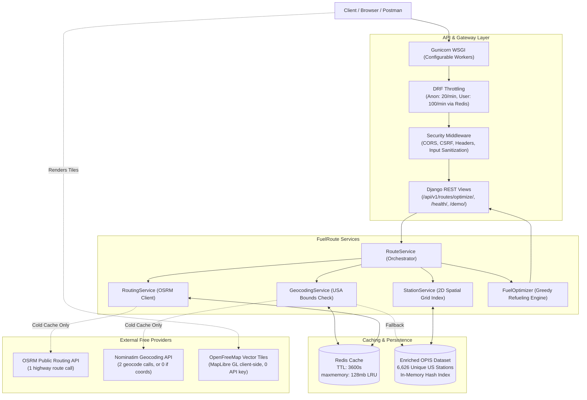

# FuelRoute — Intelligent Fuel Stop Optimization API

[](https://www.python.org/)
[](https://www.djangoproject.com/)
[](https://www.django-rest-framework.org/)
[](https://www.docker.com/)
[]()

FuelRoute is a production-grade backend service built with Django REST Framework for the Spotter Backend Engineer Assessment. It calculates turn-by-turn driving routes across the United States, extracts candidate fuel stations from the provided OPIS dataset along a route corridor, and solves the vehicle refueling optimization problem to minimize total fuel expenditure under strict vehicle range and efficiency constraints.

---

## 1. Problem

Commercial long-haul trucking operations in the United States require cost-efficient refueling planning along transit corridors:

- **Start & Destination**: Valid locations anywhere within the continental United States, Alaska, or Hawaii.
- **Vehicle Constraints**:
  - Maximum driving range: **500 miles** per full tank.
  - Fuel economy: **10 MPG** (equivalent to a **50-gallon tank capacity**).
  - Starting condition: **Full 50-gallon tank** at origin.
  - Initial fuel accounting: The initial 50 gallons in the tank are **not charged** (already paid for before departure).
- **Refueling Objective**: Minimize total out-of-pocket fuel money spent by selecting the lowest-priced reachable truck stops along the corridor without ever running out of fuel (no leg exceeding 500 miles).
- **Provided Data**: Retail fuel price dataset (`fuel-prices-for-be-assessment.csv`) with ~8,151 truck stop records (OPIS ID, truck stop name, address, city, state, price).
- **API Efficiency**: Minimize external routing and geocoding network calls (1 routing API call, 0 per-station calls).

---

## 2. Architecture



---

## 3. API Specification

| Method | Endpoint | Description | Auth / Throttle |
| :--- | :--- | :--- | :--- |
| `POST` | `/api/v1/routes/optimize/` | Computes route, candidate stations, and optimal fuel stops | 20 req/min anon, 100 req/min user |
| `GET` | `/health/` | Full readiness check (Redis status + fuel dataset count) | Unthrottled |
| `GET` | `/health/live/` | Ultra-lightweight liveness probe for container orchestrators | Unthrottled |
| `GET` | `/health/ready/` | Kubernetes/Docker readiness probe | Unthrottled |
| `GET` | `/demo/` | Interactive MapLibre vector map dashboard | Unthrottled |

---

## 4. Request and Response Examples

### Request: Address Strings
```json
{
  "start": "New York, NY",
  "finish": "Chicago, IL"
}
```

### Request: Explicit Coordinate Objects
```json
{
  "start": {
    "latitude": 40.7128,
    "longitude": -74.0060
  },
  "finish": {
    "latitude": 41.8781,
    "longitude": -87.6298
  }
}
```

### Response (`200 OK`)
```json
{
  "request": {
    "start": "New York, NY",
    "finish": "Chicago, IL"
  },
  "vehicle": {
    "max_range_miles": 500,
    "mpg": 10,
    "starting_tank": "full"
  },
  "route": {
    "start_resolved": "New York, United States",
    "finish_resolved": "Chicago, South Chicago Township, Cook County, Illinois, United States",
    "distance_miles": 790.57,
    "duration_minutes": 890.8,
    "geometry": {
      "type": "LineString",
      "coordinates": [
        [-74.0060, 40.7128],
        [-80.6474, 41.0986],
        [-87.6298, 41.8781]
      ]
    }
  },
  "fuel_stops": [
    {
      "station_id": "72445",
      "station_name": "SHEETZ #639",
      "address": "I-80 Exit 223",
      "city": "Youngstown",
      "state": "OH",
      "price_per_gallon": 3.059,
      "distance_from_start_miles": 390.3,
      "gallons_purchased": 5.47,
      "cost": 16.73,
      "latitude": 41.0986,
      "longitude": -80.6474
    },
    {
      "station_id": "18042",
      "station_name": "S&G #88",
      "address": "1456 W Laskey Rd",
      "city": "Toledo",
      "state": "OH",
      "price_per_gallon": 3.009,
      "distance_from_start_miles": 554.7,
      "gallons_purchased": 23.59,
      "cost": 70.97,
      "latitude": 41.6528,
      "longitude": -83.5379
    }
  ],
  "fuel_summary": {
    "total_gallons_consumed": 79.06,
    "total_gallons_purchased": 29.06,
    "total_fuel_cost": 87.71
  },
  "meta": {
    "routing_provider": "OSRM",
    "route_corridor_miles": 25.0,
    "candidate_station_count": 368,
    "fuel_stop_count": 2
  }
}
```

---

## 5. Fuel Optimization Algorithm

FuelRoute implements a **greedy fuel-stop optimization algorithm with backward reachability analysis** (rather than unconstrained dynamic programming).

### Step 1: Backward Reachability Pruning
Before simulating vehicle progress forward, the algorithm builds a directed reachability graph from Destination backwards to Start:
- A station node $i$ can reach destination if $(x_D - x_i) \le 500$ miles, OR there exists a downstream station $j > i$ such that $(x_j - x_i) \le 500$ miles and $j$ can reach the destination.
- If the vehicle at Start ($x=0$) cannot reach any station that can reach the destination, or if any gap between consecutive reachable stations exceeds 500 miles, the algorithm immediately rejects the trip with HTTP 422 `NoFeasibleFuelPlan`.

### Step 2: Forward Greedy Simulation
The vehicle advances along the route keeping track of current location $x_u$, fuel remaining in tank $F$, and total purchased fuel:

1. **Starting State**:
   - Vehicle starts at $x_0 = 0$ with a full 50-gallon tank ($F = 50.0$).
   - Initial fuel is free (never added to `total_fuel_cost`).
2. **Cheapest Reachable Decision**:
   - From current node $u$ with range $F \times 10$ miles:
   - **Case A (Destination Reachable)**: If destination is within reach with current fuel ($x_D - x_u \le F \times 10$), the vehicle proceeds directly to the destination without stopping.
   - **Case B (Cheaper Station Ahead in Tank Range)**: If a station $w$ exists within reachable range $(x_w - x_u \le F \times 10)$ with a price $p_w < p_u$, the vehicle drives to $w$ without buying fuel at $u$.
   - **Case C (Cheaper Station Ahead in Max Range)**: If a cheaper station $w$ exists within maximum range ($x_w - x_u \le 500$) but exceeds current fuel, the vehicle purchases *only enough fuel* to reach $w$ with 0 fuel remaining:
     $$\text{gallons} = \frac{x_w - x_u}{10} - F$$
   - **Case D (Current Station is Cheapest in Max Range)**: If no cheaper station exists within 500 miles, current station $u$ is the local minimum price:
     - If the destination is within 500 miles, buy only enough to reach the destination:
       $$\text{gallons} = \frac{x_D - x_u}{10} - F$$
     - If destination is $> 500$ miles away, fill the tank to capacity (50 gallons):
       $$\text{gallons} = 50.0 - F$$
     - Advance to the lowest-priced reachable station downstream.

### Mathematical Invariants Guaranteed:
- Initial 50 gallons are NOT charged.
- Tank capacity strictly $\le 50$ gallons at all times (no overflow).
- Fuel remaining never drops below 0 (no negative fuel).
- No individual driving leg exceeds 500 miles.
- Micro-stops ($< 0.01$ gallons) are discarded.
- Gallons purchased = $\max(0, \text{Total Consumed} - 50.0)$ across the full trip.

---

## 6. Why Only One Routing Call is Needed

Standard naive implementations make repeated routing calls:
- 1 call for initial route
- $N$ calls to compute detours to every candidate station
- $K$ calls to recalculate routes between selected stops

**FuelRoute avoids all redundant network calls:**
1. **Single Polyline Call**: Exactly **one OSRM routing call** computes the global turn-by-turn driving route and polyline geometry.
2. **Local Projection**: Station locations are projected onto the cumulative mileage axis of the polyline using Haversine orthogonal projection.
3. **Zero Sub-Route Calls**: The algorithm optimizes along the projected 1D route axis locally in-memory.
4. **Call Count Result**:
   - **Coordinate inputs**: Exactly **1 routing call** (cold cache), **0 routing calls** (warm cache).
   - **Address inputs**: Exactly **2 geocoding calls** + **1 routing call** (cold cache), **0 calls** (warm cache).
   - **Per-station calls**: **0 external network requests**.

---

## 7. Spatial Station Filtering

The provided OPIS dataset contains ~8,151 records. Comparing all stations against thousands of polyline coordinates would require $O(N \cdot M) \approx 1.6\times 10^6$ distance calculations per request.

### Spatial Grid Architecture:
1. **Offline Preprocessing**:
   - Deduplicated by OPIS Truckstop ID (retaining minimum price).
   - Mapped to city centroids.
   - Saved as compact JSON (`data/enriched_fuel_stations.json`, 6,626 unique stations).
2. **2D Hash Grid Index**:
   - On startup, stations are bucketed into a spatial grid: `(int(lat * 2.0), int(lon * 2.0))` with cell size of 0.5° (~35 miles).
3. **Route Polyline Sampling**:
   - The route polyline is sampled every 2.0 miles.
   - For each sample point, only the 9 adjacent spatial buckets (3x3 grid) are queried.
   - Fast bounding boxes filter out non-candidates before Haversine calculation.
4. **Efficiency**: Candidate station filtering along a 3,300-mile cross-country route executes in **under 15 milliseconds** with zero external database dependencies.

---

## 8. Redis Caching

FuelRoute uses Redis 7 with LRU memory eviction:
- **Routing Cache**: Keyed deterministically by 4-decimal rounded coordinates (`route:lat1:lon1:lat2:lon2`). TTL = 3,600s.
- **Geocoding Cache**: Keyed by sanitized lowercase query string (`geocode:address`). TTL = 3,600s.
- **Graceful Degradation**: Configured with `IGNORE_EXCEPTIONS = True`. If Redis is temporarily unavailable, API requests bypass cache and query upstream providers without crashing.
- **Memory Management**: Redis is configured with `--maxmemory 128mb --maxmemory-policy allkeys-lru`.

---

## 9. Rate Limiting

Rate limiting protects upstream public APIs and prevents denial-of-service:
- **Anonymous limit**: `20/minute` (configurable via `ANON_RATE_LIMIT`).
- **Authenticated limit**: `100/minute` (configurable via `USER_RATE_LIMIT`).
- **Redis-Backed Synchronization**: DRF's `THROTTLE_CACHE = 'default'` uses Redis across all Gunicorn workers.
- **Clean 429 Responses**: Exceeding rate limits returns a clean JSON response with `Retry-After` header:
  ```json
  {
    "error": "RateLimitExceeded",
    "message": "Too many requests. Please try again in 59 seconds."
  }
  ```
- **Health Check Exemption**: `/health/`, `/health/live/`, and `/health/ready/` explicitly bypass throttling to prevent monitoring false alarms.

---

## 10. Docker Setup

FuelRoute includes a multi-container Docker deployment:

- **Base Image**: `python:3.11-slim` with pinned dependencies in `requirements.txt`.
- **Security**: Runs under an unprivileged non-root user (`appuser:appuser`, UID 1000).
- **Application Server**: Gunicorn WSGI server. Worker count is configurable via `GUNICORN_WORKERS` (default `3`).
- **Health Probes**: Built-in container healthchecks for both API (`curl -f http://localhost:8000/health/`) and Redis (`redis-cli ping`).
- **Docker Compose**: Orchestrates `fuelroute-api` and `fuelroute-redis` with automatic dependency ordering (`condition: service_healthy`).

---

## 11. Tests

The automated test suite contains **74 unit and integration tests** executed via pytest:

```bash
# Run pytest locally
pytest -v

# Run pytest inside Docker
docker compose exec web pytest -v
```

### Coverage Highlights:
- **Fuel Optimization**: Zero-stop routes (<500 mi), exact 500-mile boundaries, 501-mile 1-stop routes, expensive bridge stations, avoiding excess purchases at expensive stations, starting fuel preservation, no negative fuel, multi-stop cross-country routes.
- **External Call Efficiency**: Mocked HTTP assertions verifying 1 routing call and 0 per-station calls.
- **Spatial Filtering**: Deduplication, positive price validation, Haversine accuracy, corridor width enforcement.
- **Security & Validation**: Oversized strings (>200 chars), CRLF log injection, out-of-bounds USA coordinates, latitude/longitude boundary checks.
- **Resilience & Caching**: Cache hits, upstream timeouts, upstream 429 rate limits, upstream 500 errors, malformed JSON, Redis outage fallback.
- **Health & Probes**: `/health/`, `/health/live/`, `/health/ready/` endpoints.

---

## 12. Dataset Coordinate Limitation

> [!IMPORTANT]
> **The supplied assessment dataset does not contain station coordinates. Station locations are approximated using city/state coordinates from a static US city dataset. Production deployment should use actual station coordinates.**

- The assessment CSV (`fuel-prices-for-be-assessment.csv`) contains:
  `['OPIS Truckstop ID', 'Truckstop Name', 'Address', 'City', 'State', 'Rack ID', 'Retail Price']`.
- No latitude or longitude coordinates were provided in the dataset.
- Station locations are mapped to city centroids via static US Census/GNIS data (`data/us_cities.csv`).
- The 25-mile corridor tolerance accounts for the distance between Interstate highway exits and city centroids.
- Stations with duplicate OPIS IDs are deduplicated by keeping the lowest retail price. Missing city/state records and non-positive prices ($\le 0$) are safely pruned during preprocessing.

---

## 13. Production Limitations

For enterprise deployment, the following adjustments should be made:
1. **Self-Hosted OSRM**: Replace the public OSRM demo server (`router.project-osrm.org`) with a self-hosted OSRM North America instance to remove public rate limits.
2. **Pinpoint GPS Coordinates**: Replace city-level approximations with exact station curb coordinates or Interstate highway exit numbers.
3. **Live Price Feeds**: Integrate real-time OPIS wholesale or retail price APIs with Celery/Redis scheduled tasks.
4. **SSL / TLS Termination**: Terminate HTTPS at an ingress reverse proxy (e.g. AWS ALB, Cloudflare, or Nginx) and enable `SECURE_SSL_REDIRECT = True` and `SECURE_HSTS_SECONDS = 31536000`.

---

## 14. How to Run

### Option 1: Docker (Recommended)
```bash
# Clone the repository
git clone https://github.com/your-username/spotter-FuelRoute.git
cd spotter-FuelRoute

# Start Redis and API containers
docker compose up --build -d

# Verify containers are healthy
docker compose ps
```

### Option 2: Local Python Virtual Environment
```bash
# Create and activate virtual environment
python -m venv .venv
source .venv/bin/activate  # Or on Windows: .\.venv\Scripts\activate

# Install dependencies
pip install -r requirements.txt

# Run migrations (creates minimal sqlite if needed)
python manage.py migrate

# Start local server
python manage.py runserver 8000
```

---

## 15. Example Routes

### 1. Short Route: Philadelphia, PA → Washington, DC
- **Distance**: 137.1 miles
- **Fuel Stops**: 0 stops
- **Fuel Consumed**: 13.71 gallons
- **Fuel Purchased**: 0.0 gallons
- **Total Cost**: **$0.00** (covered entirely by initial 50-gallon tank)

### 2. Medium Route: New York, NY → Chicago, IL
- **Distance**: 790.57 miles
- **Fuel Stops**: 2 stops (Sheetz #639 in Youngstown, OH & S&G #88 in Toledo, OH)
- **Fuel Consumed**: 79.06 gallons
- **Fuel Purchased**: 29.06 gallons
- **Total Cost**: **$87.71**

### 3. Cross-Country Route: Seattle, WA → Miami, FL
- **Distance**: 3,301.58 miles
- **Fuel Stops**: 17 stops
- **Fuel Consumed**: 330.16 gallons
- **Fuel Purchased**: 280.16 gallons
- **Total Cost**: **$847.56**
- **Range Verification**: Every leg between stops is strictly under 500 miles.

---

## Interactive Browser Demonstration

Visit [http://localhost:8000/demo/](http://localhost:8000/demo/) in your browser:
- Interactive MapLibre GL map powered by OpenFreeMap vector tiles (zero API keys).
- Enter origin and destination (city/state or coordinates).
- Visualizes route line, start/finish pins, and numbered fuel stop markers with full purchase breakdown.
